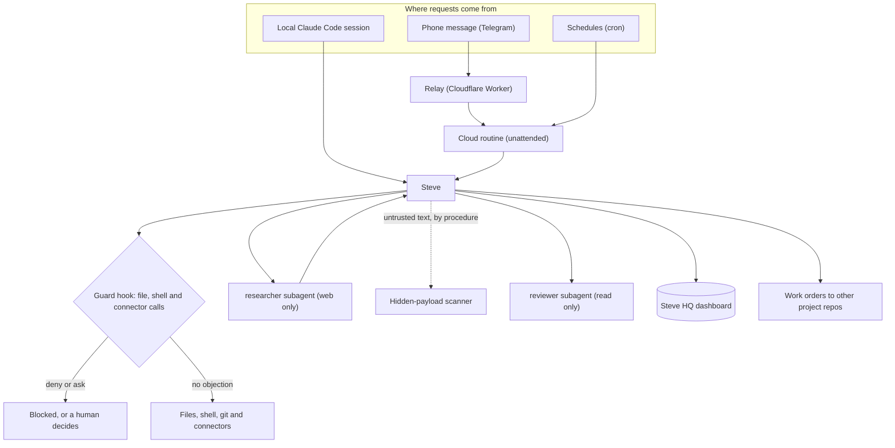

# SOLUTION-OS: a chief-of-staff agent on Claude Code

> **Case study.** The source is private because it holds my personal admin and private project context. This page covers the design, the evidence and the limits. Figures are as of 19 Nov 2026.

## The problem

I run several projects at once. Context gets lost between sessions, routine admin eats the day, and an AI agent with access to files and a shell is a real risk if nothing constrains it. I wanted an agent that does real work across my projects and can be left running safely.

## What it does

**Steve** is the agent at the centre of SOLUTION-OS. He:

- **briefs** me with a morning brief, an evening wrap and a weekly review. These run as scheduled cloud routines and land on a private dashboard (Steve HQ);
- **captures and routes** requests, including messages sent from my phone;
- **does the work** in a local Claude Code session, or writes a work order and hands it to the right project's own session, where that project allows it;
- **researches** through a quarantined subagent that only has web tools, and sends every plan to an independent, read-only reviewer subagent before it reaches me.

## Architecture

The same rules are enforced differently depending on where the agent runs:

| Runtime | Enforcement | Who answers prompts |
|---|---|---|
| Windows (local) | No OS sandbox, so the hook and permission rules are the only enforcement | Me |
| WSL2 (local) | OS sandbox available; Windows drives not mounted | Me |
| Cloud routine | Fresh clone in a VM; the dashboard is the only output | Nobody, so every "ask" becomes "deny" |

## Engineering highlights

### 1. A guard hook that fails closed
Every file, shell and connector call passes through a `PreToolUse` hook (about 725 lines, 64 tests). It returns *deny*, *ask* or no objection, and never an explicit *allow*.

- Claude Code only blocks on exit code 2 or a JSON decision, so a hook that crashes lets the call through. This guard always exits cleanly with an explicit decision, and treats its own errors (bad config, a path it can't resolve) as an ask.
- An "ask" only protects you if a human is there to answer it. In unattended runs (cloud routines, don't-ask and bypass modes) every ask becomes a deny.
- It resolves Windows, Git Bash, WSL and POSIX paths, and reads its policy from a config file rather than hard-coding it.
- It denies reads of secrets, destructive commands, recursive deletes outside throwaway build folders, and wildcards that could reach sensitive folders. Edits to its own governance files raise a prompt (in auto mode, Claude Code's classifier decides).

### 2. A hidden-payload scanner, run by procedure
Email, web and document text is treated as data. Before any of it goes into the dashboard, a draft or a tool, the agent's rules require it to go through a scanner. The scanner flags zero-width, bidi and Unicode tag characters, variation selectors, HTML comments, script and data URLs, and long base64 blobs. It never echoes the text back, and its docs say plainly that a clean result means "no hidden characters", not "safe". The scanner is code, but calling it is still a written rule rather than a hook. Wiring it into a hook is the next step.

### 3. Phone to cloud and back
A Telegram message goes to a Cloudflare Worker relay, which fires a cloud routine, which replies through the relay. Secrets are compared in constant time, and error messages give the reason without revealing keys. The chain has 15 tests.

### 4. An evidence habit
- Claims about finished work carry a label: *verified (auto)*, *verified (observed)*, *needs Sol* or *not verified*.
- There are 13 decision records and 42 lessons. Since late September, each lesson is written as pattern, root cause, signal and "next time".
- A routine-audit skill reads the logs of past cloud runs and checks each run did what its skill requires, without paying for new runs.

### 5. Few moving parts
The guard, tools and relay are plain Node ESM with no npm dependencies. The optional voice companion is separate Python code with its own pinned packages.

## Lessons that shaped it

- **Test where it runs.** The guard passed every test on Windows but was blind in the cloud, because paths resolve differently there. It was fixed and then proven with a real cloud run log.
- **Error paths need tests too.** One change to the rules would have let a *broken* guard fail open in auto mode. Review caught it before it did harm, and error handling now gets tested as hard as the normal path.
- **Independent review earns its cost.** The first reviewer pass found nine major issues in the agent's own plan.

## Limits

- On Windows there's no OS sandbox. The main session reads untrusted web text and can fetch URLs without a prompt, so the hook and the written rules are the only controls there.
- The shell check is heuristic. A deliberately crafted command could get past it, and it still has false positives.
- There's no always-on listener. Reminders aren't pushed at an exact time, and with my PC off only the cloud routines run.
- It's a single-user internal tool, not a product.

## By the numbers (19 Nov 2026)

| | |
|---|---|
| Commits | 152 (since 22 Sep 2026) |
| Tests | 167 passing, 0 failing (`npm test`, 19 Nov 2026); 64 of them on the guard |
| Decision records | 13 |
| Lessons logged | 42 |
| Cloud routines | 6 |
| Skills | 14 in the repo + 10 in a reusable plugin |
| Subagents | 2 (researcher, reviewer) |
| npm dependencies | 0 (guard, tools and relay) |

## Stack

Node.js (ESM) · Python · Claude Code hooks, skills, subagents, plugins and cloud routines · Cloudflare Workers · Telegram Bot API · GitHub
